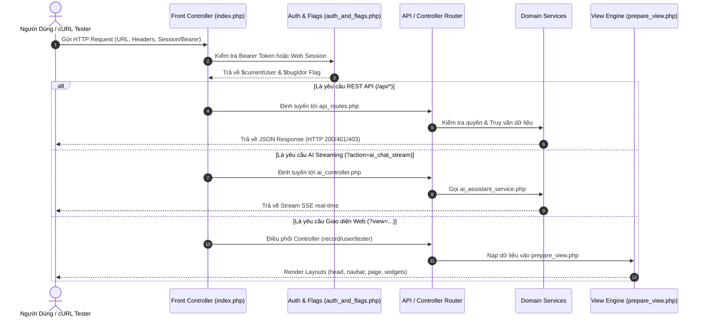
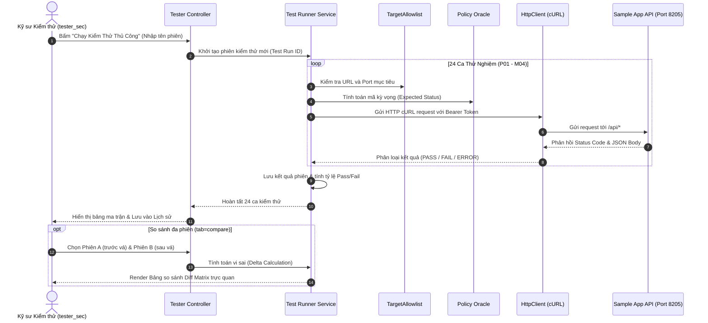

# Tài Liệu Thiết Kế Kiến Trúc Hệ Thống – AccessTester & MediRecord EMR

**Học phần:** Phát triển phần mềm mã nguồn mở  
**Đề tài 4:** Xây dựng công cụ kiểm thử tự động quyền truy cập trong ứng dụng Web  
**Sinh viên thực hiện:** Nhóm 13 (Repository Nhóm 14)  
**Phiên bản tài liệu:** 3.0.0 (Cập nhật Kiến trúc Modular MVC, AI Streaming SSE, Manual Testing & Comparative Analytics)  

---

## 1. Tổng Quan Kiến Trúc Hệ Thống

Hệ thống được thiết kế theo mô hình kiến trúc phân tầng độc lập (Decoupled Multi-Tier Architecture), phân định ranh giới trách nhiệm rõ ràng giữa **Công cụ kiểm thử phân quyền (AccessTester Engine)**, **Cơ sở dữ liệu tập trung (PostgreSQL)**, và **Ứng dụng Web Bệnh án Điện tử mẫu (MediRecord EMR Target)**:

```
+-------------------------------------------------------------------------------------------------------+
|                                    HỆ THỐNG KIỂM THỬ AN NINH (ACCESSTESTER)                            |
|                                                                                                       |
|   +--------------------------+                         +------------------------------------------+   |
|   |   Giao diện Web (8105)   |                         |           Dòng lệnh CLI Runner           |   |
|   |      (public/*.php)      |                         |              (bin/run.php)               |   |
|   +------------+-------------+                         +--------------------+---------------------+   |
|                |                                                            |                         |
|                +------------------------------+-----------------------------+                         |
|                                               |                                                       |
|                                               v                                                       |
|                                 +---------------------------+                                         |
|                                 |      Runner Controller    |                                         |
|                                 |     (Tính config_hash)    |                                         |
|                                 +-------------+-------------+                                         |
|                                               |                                                       |
|               +-------------------------------+-------------------------------+                       |
|               |                               |                               |                       |
|               v                               v                               v                       |
|       +---------------+               +---------------+               +---------------+               |
|       | Policy Oracle |               | TargetAllowlist|              |    Redactor   |               |
|       |  (RBAC/ABAC)  |               | (Duyệt Host)  |               | (Khử bí mật)  |               |
|       +-------+-------+               +-------+-------+               +-------+-------+               |
|               |                               |                               |                       |
|               +-------------------------------+-------------------------------+                       |
|                                               |                                                       |
|                                               v                                                       |
|                                 +---------------------------+                                         |
|                                 |        HttpClient         |                                         |
|                                 |   (cURL thật, độc lập)    |                                         |
|                                 +-------------+-------------+                                         |
+-----------------------------------------------|-------------------------------------------------------+
                                                |
                         +----------------------+----------------------+
                         | Gửi HTTP cURL thật                          | Lưu trữ & Snapshotting
                         | (Xác thực Bearer Token)                     | (Truy vấn tham số hóa PDO)
                         v                                             v
+-----------------------------------------------------------+   +---------------------------------------+
|    ỨNG DỤNG MẪU BỆNH ÁN ĐIỆN TỬ - MEDIRECORD EMR (8205)   |   |     CƠ SỞ DỮ LIỆU (POSTGRESQL 14+)    |
|                                                           |   |                                       |
| - Kiến trúc Modular MVC (36 file cấu trúc rõ ràng)        |   | - Database: accesstest_lab            |
| - 6 REST APIs chuẩn + Web UI Glassmorphism                |   | - Schema public:                      |
| - Công tắc lỗi IDOR cố ý (BUG_IDOR=1/0)                   |   |   + projects, project_members         |
| - Trung tâm Giám sát An ninh tích hợp:                    |   |   + roles, resources, actions         |
|   + Live Incident Feed (Cảnh báo vi phạm thời gian thực)  |   |   + permissions, records              |
|   + Manual 24-Case Test Runner (Kiểm thử ma trận thủ công)|   |   + test_accounts, test_cases         |
|   + Comparative Analytics (Đối chiếu đa phiên kiểm thử)   |   |   + runs, run_results                 |
|   + Hold-to-Confirm Modal (Cơ chế nhấn giữ an toàn)       |   | - Schema sample_app:                  |
| - Trợ lý AI MediRecord (SSE Streaming + Robot 3D Canvas)   |   |   + users, notes, announcements       |
+-----------------------------------------------------------+   +---------------------------------------+
```

---

## 2. Kiến Trúc Modular MVC Của Ứng Dụng Mẫu (Sample App)

Trước đây, ứng dụng mẫu được thiết kế nguyên khối (monolithic) với hơn 11.000 dòng mã trong tập tin `sample-app/public/index.php`. Nhằm đáp ứng tiêu chuẩn phần mềm hiện đại, nâng cao tính bảo trì, khả năng mở rộng và kiểm thử độc lập, toàn bộ ứng dụng đã được tái cấu trúc hoàn chỉnh thành **Kiến trúc Modular MVC gồm 36 tập tin** phân định rõ ràng:

```
Ma_nguon/sample-app/
├── schema.sql                         # Khởi tạo bảng users, notes, announcements
├── app/
│   ├── bootstrap/                     # Tầng nạp môi trường, hàm tiện ích, cấu hình
│   │   ├── helpers.php                # e(), format_date(), render_flash(), get_current_user()
│   │   ├── init_data.php              # Kết nối PDO, tạo schema/dữ liệu mẫu SQLite fallback
│   │   └── auth_and_flags.php         # Xác thực Session/Bearer, cờ BUG_IDOR, Fast Switcher
│   ├── services/                      # Tầng nghiệp vụ xử lý logic độc lập
│   │   ├── security_service.php       # Ghi nhận sự cố IDOR, xử lý live feed cảnh báo
│   │   ├── test_runner_service.php    # Quản lý 24 ca ma trận, phiên kiểm thử, tính toán delta
│   │   └── ai_assistant_service.php   # Prompt an toàn ABAC, cURL OpenRouter/Groq/Gemini
│   ├── controllers/                   # Tầng điều phối luồng người dùng và API
│   │   ├── ai_controller.php          # Xử lý SSE stream real-time, xóa lịch sử, gợi ý prompt
│   │   ├── tester_controller.php      # Điều phối 4 tab: sự cố, ma trận, so sánh, 88 CLI tests
│   │   ├── auth_controller.php        # Đăng nhập, đăng ký, đăng xuất, chuyển vai trò tức thì
│   │   ├── user_controller.php        # Quản trị người dùng toàn viện (CRUD + Instant Search)
│   │   ├── record_controller.php      # Lập, xem, sửa bệnh án; trực quan hóa lỗ hổng IDOR
│   │   └── announcement_controller.php# Xem danh sách thông báo y tế chung
│   ├── api/                           # Bộ định tuyến REST API độc lập
│   │   └── api_routes.php             # 6 REST API chuẩn phục vụ kiểm thử cURL và Bearer Token
│   └── views/                         # Tầng hiển thị giao diện người dùng
│       ├── prepare_view.php           # Chuẩn bị dữ liệu hiển thị theo tham số ?view=
│       ├── layouts/                   # Khung giao diện dùng chung
│       │   ├── head.php               # HTML Head, Google Fonts, Token CSS, Toast containers
│       │   ├── navbar.php             # Menu điều hướng kính mờ, User status pill
│       │   └── idor_banner.php        # Banner cảnh báo trạng thái cờ BUG_IDOR đỏ/xanh
│       ├── pages/                     # 10 Trang giao diện người dùng
│       │   ├── landing.php            # Trang chủ giới thiệu năng lực, bảng đối chiếu, 1-click login
│       │   ├── login.php              # Đăng nhập với nút điền nhanh tài khoản kiểm thử
│       │   ├── register.php           # Đăng ký thành viên mới
│       │   ├── profile.php            # Hồ sơ cá nhân người dùng
│       │   ├── records_list.php       # Danh sách bệnh án theo quyền sở hữu ABAC
│       │   ├── record_create.php      # Giao diện bác sĩ lập chẩn đoán và gửi bệnh án
│       │   ├── record_detail.php      # Chi tiết bệnh án (điểm nổ lỗi IDOR khi xem)
│       │   ├── record_edit.php        # Chỉnh sửa bệnh án (điểm nổ lỗi IDOR khi cập nhật)
│       │   ├── announcements.php      # Thông báo chung bệnh viện
│       │   └── users.php              # Quản trị viên quản lý nhân sự y tế
│       ├── tester/                    # Trung tâm Giám sát An ninh & Kiểm thử cho tester_sec
│       │   ├── index.php              # Shell điều hướng 4 tab giám sát an ninh
│       │   ├── tab_incidents.php      # Tab 1: Live Incident Feed cảnh báo xâm phạm
│       │   ├── tab_matrix.php         # Tab 2: Ma trận 24 ca kiểm thử thủ công
│       │   ├── tab_compare.php        # Tab 3: So sánh lịch sử kiểm thử đối chiếu đa phiên
│       │   └── tab_full_tests.php     # Tab 4: Thực thi bộ 88 bài test CLI hệ thống
│       └── partials/
│           └── floating_widgets.php   # Dock 3 nút nổi FAB, AI Modal, Fast Switcher, Terminal Drawer
└── public/
    ├── index.php                      # Front Controller siêu gọn nhẹ (79 dòng)
    └── assets/
        ├── css/app.css                # Toàn bộ CSS phong cách Modern SaaS Glassmorphism
        ├── js/app.js                  # Logic tương tác UI, SSE AI client, Hold-to-confirm modal
        ├── robot-heads.bundle.js      # Widget Robot 3D Canvas Procedural tương tác chuyển động
        └── images/                    # Hình ảnh y tế chất lượng cao (bachmai_hero.jpg, banner.png)
```

### Nguyên lý hoạt động của Front Controller (`public/index.php`):
Tập tin `public/index.php` đóng vai trò là điểm đón tiếp duy nhất (Single Point of Entry):
1. Nạp hằng số đường dẫn `SAMPLE_APP_ROOT` và `SAMPLE_PUBLIC_DIR`.
2. Khởi tạo session PHP, nạp tiện ích `helpers.php` và cơ sở dữ liệu `init_data.php`.
3. Kiểm tra xác thực Bearer Token hoặc Web Session qua `auth_and_flags.php`.
4. Định tuyến ưu tiên:
   - Nếu đường dẫn bắt đầu bằng `/api/` -> chuyển giao cho `app/api/api_routes.php`.
   - Nếu yêu cầu tác vụ AI (`?action=ai_...`) -> gọi `app/controllers/ai_controller.php`.
   - Nếu là yêu cầu kiểm thử (`?view=tester`) -> chuyển sang `app/controllers/tester_controller.php`.
   - Xử lý các tác vụ POST của Auth, Records, Users qua các Controller chuyên trách.
5. Nạp `prepare_view.php` để lấy dữ liệu trang, sau đó kết hợp các thành phần giao diện trong `app/views/layouts/` và `app/views/pages/` để render trang HTML hoàn chỉnh.

---

## 3. Động Cơ Kiểm Thử An Ninh & Phân Quyền (AccessTester Engine)

Động cơ kiểm thử độc lập AccessTester được xây dựng nhằm tự động hóa việc rà quét phân quyền trong các hệ thống Web theo các nguyên tắc an toàn nghiêm ngặt:

### 3.1. Động cơ Phân Quyền Kép (Policy Oracle – `src/Policy.php`)
- **Nguyên tắc an toàn cốt lõi (Yêu cầu kỹ thuật 1):** Mặc định luôn là **`DENY`**. Mọi tài nguyên chưa được định nghĩa tường minh hoặc yêu cầu từ người dùng chưa xác thực (ẩn danh) khi gọi API yêu cầu bảo vệ đều bị từ chối truy cập.
- **Mô hình kết hợp RBAC & ABAC:**
  - **RBAC (Role-Based Access Control):** Phân quyền dựa trên vai trò của tài khoản (`admin`, `doctor`, `member`, `auditor`).
  - **ABAC (Attribute-Based Access Control):** Phân quyền theo thuộc tính chủ sở hữu (`scope = 'own'`). Hệ thống kiểm tra `ownerMatch` giữa `user_id` hiện tại và trường `owner_id` của bản ghi trong bảng `records`.
- **Policy Oracle:** Hàm `Policy::computeExpectedForCase($pdo, $case)` hoạt động như một quan tòa khách quan, tự động truy vấn CSDL để xác định mã HTTP và trạng thái kỳ vọng chuẩn mực cho bất kỳ ca thử nào mà không bị ảnh hưởng bởi lỗi ở phía ứng dụng Web mục tiêu.

### 3.2. Kiểm Soát Máy Chủ An Toàn (Target Allowlist – `src/TargetAllowlist.php`)
- Ngăn ngừa công cụ bị lợi dụng để tấn công Server-Side Request Forgery (SSRF) hoặc quét trái phép mạng bên ngoài.
- Nạp cấu hình từ `config/targets.json`:
  - Chỉ chấp nhận scheme `http` và `https`.
  - Chỉ chấp nhận IP `127.0.0.1`, `::1` hoặc tên miền `localhost`.
  - Giới hạn các cổng được phê duyệt: `8205` (Sample App chính thức), `8295`, `8296`, `8297`, `8298`.
  - Mọi yêu cầu vi phạm sẽ bị từ chối ngay lập tức với mã lỗi `TARGET_NOT_ALLOWED`.

### 3.3. Trình Gửi HTTP Thực Tế & Phân Loại 3 Trạng Thái (`src/HttpClient.php`)
- **Yêu cầu kỹ thuật 2:** Gửi yêu cầu HTTP thật bằng thư viện cURL của PHP, tạo phiên độc lập hoàn toàn cho từng ca thử (không dùng chung cookie hay bộ đệm).
- **Phân loại kết quả (Phép thử 3):**
  - **`ERROR`:** Gặp lỗi mạng (`CONNECT_FAILED`), quá thời gian (`TIMEOUT`), máy chủ đích không nằm trong danh sách duyệt (`TARGET_NOT_ALLOWED`), hoặc máy chủ lỗi nội bộ HTTP 500 (`SERVER_ERROR`).
    > *Lưu ý sống còn:* Sự cố lỗi mạng hoặc máy chủ đóng cổng **tuyệt đối không bao giờ được phân loại là DENY hay PASS**.
  - **`FAIL`:** Máy chủ phản hồi mã HTTP không khớp với kỳ vọng của Policy Oracle, hoặc phản hồi chứa chuỗi rò rỉ dữ liệu bị cấm (`must_not_contain`) ngay cả khi trả về HTTP 200.
  - **`PASS`:** Kết quả phản hồi thực tế khớp hoàn toàn với mong đợi của Policy Oracle và không chứa bất kỳ chuỗi rò rỉ nào.

### 3.4. Khử Dữ Liệu Nhạy Cảm (Redactor – `src/Redactor.php`)
- Bảo vệ dữ liệu nhạy cảm theo tiêu chuẩn an toàn thông tin (Phép thử 5).
- Tự động nạp danh sách các token bí mật từ biến môi trường và quá trình chạy.
- Quét và thay thế bằng chuỗi an toàn `***REDACTED***`:
  - Các tiêu đề HTTP nhạy cảm: `Authorization: Bearer <token>`, `X-Api-Key`, `Cookie`.
  - Mật khẩu người dùng trong payload JSON, form-data hoặc query string: `password`, `matkhau_lab_123`.
  - Dữ liệu trước khi ghi ra nhật ký `.local/runner.log`, lưu vào CSDL hoặc xuất ra file báo cáo Markdown/HTML đều bắt buộc phải đi qua `Redactor`.

### 3.5. Bảo Toàn Toàn Vẹn Dữ Liệu Độc Lập (Snapshotting & Runs Repository – `src/RunRepository.php`)
- Mỗi lần chạy kiểm thử được ghi nhận trong bảng `runs` với một mã băm cấu hình `config_hash = hash('sha256', json_encode($cases))` và bản chụp `config_snapshot`.
- Kết quả từng ca thử được lưu vào bảng `run_results` với đầy đủ bản chụp thông tin cấu hình tại thời điểm chạy: `case_code`, `method`, `path`, `expected_status`, `must_contain`, `must_not_contain`.
- **Tính bất biến (Idempotent):** Nếu trong tương lai người dùng thêm, sửa hoặc xóa ca thử trong bảng `test_cases`, lịch sử của các lần chạy trước vẫn được bảo toàn nguyên vẹn 100%, không bị sai lệch dữ liệu.

---

## 4. Trung Tâm Giám Sát An Ninh & Kiểm Thử So Sánh

Tại ứng dụng MediRecord EMR, Kỹ sư An toàn thông tin (`tester_sec`) được trang bị Trung tâm Giám sát An ninh tích hợp gồm 4 tab chuyên sâu:

### 4.1. Ma Trận 24 Ca Kiểm Thử Thủ Công (`tab=matrix`)
- Chuyển đổi từ cơ chế tự động chạy ngầm mỗi khi tải trang sang **Cơ chế Kiểm thử Thủ công Theo Yêu Cầu (Manual On-Demand Testing)**.
- Người dùng có thể:
  - Tùy ý đặt tên phiên kiểm thử (ví dụ: *"Kiểm thử trước vá lỗi*", *"Xác thực sau bản vá Hotfix 1.2"*).
  - Chọn thực thi toàn bộ 24 ca hoặc kiểm thử từng phân hệ riêng biệt (Notes, Records, Profile, Users, Announcements).
  - Quan sát kết quả chi tiết từng ca thử: Mã trạng thái HTTP thực tế, kỳ vọng, trạng thái rò rỉ dữ liệu, và kết luận PASS/FAIL.

### 4.2. So Sánh Lịch Sử Kiểm Thử Đối Chiếu Đa Phiên (`tab=compare`)
- Quản lý kho lưu trữ toàn bộ các phiên kiểm thử đã chạy (lưu trong phiên làm việc hoặc CSDL).
- **Phân tích Delta biến động (Comparative Analytics):**
  - So sánh trực tiếp giữa 2 phiên bất kỳ (Phiên cơ sở vs Phiên đối chiếu).
  - Thống kê tỷ lệ thay đổi: Số ca chuyển từ FAIL sang PASS (được vá lỗi), PASS sang FAIL (lỗi tái phát - regression), và ca không đổi.
  - Bảng đối chiếu vi sai (Diff Matrix) tô màu trực quan: Xanh lá cho ca được khắc phục, Đỏ cho ca phát sinh lỗi, Xám cho ca ổn định.

### 4.3. Mô Hình An Toàn Nhấn Giữ Để Xác Nhận (Hold-to-Confirm Modal)
Nhằm chống thao tác bấm nhầm đối với các hành động nhạy cảm hoặc nguy hiểm (Xóa lịch sử kiểm thử, Đổi tên phiên kiểm thử, Khôi phục cài đặt gốc):
- Hệ thống áp dụng mô hình **Hold-to-Confirm Modal**:
  - Người dùng mở Modal xác nhận và bắt buộc phải **nhấn giữ chuột (hoặc chạm giữ màn hình cảm ứng) liên tục trong 1.2 giây**.
  - Thanh tiến trình hình ảnh (Visual Progress Bar) nạp dần từ 0% đến 100% kèm hiệu ứng âm thanh/chuyển động rung phản hồi.
  - Nếu nhả chuột trước 1.2 giây, hành vi lập tức bị hủy bỏ và thanh tiến trình quay về 0, đảm bảo an toàn tuyệt đối trước các cú click vô tình.

---

## 5. Kiến Trúc Trợ Lý AI Thời Gian Thực (AI Assistant Streaming)

Trợ lý ảo MediRecord AI được tích hợp tại góc dưới màn hình, hoạt động như một chuyên gia tư vấn y tế và cố vấn an toàn thông tin:

```
[Trình duyệt Web]                       [Sample App - Server]                 [OpenRouter / Cloud AI]
       |                                          |                                      |
       |--- 1. Gửi tin nhắn qua Fetch POST ------>|                                      |
       |    (?action=ai_chat_stream)              |                                      |
       |                                          |--- 2. Nạp ngữ cảnh phiên & quyền --->|
       |                                          |    (Kiểm tra ABAC của User hiện tại) |
       |                                          |--- 3. Khử dữ liệu & Lắp Prompt ----->|
       |                                          |--- 4. Mở cURL Streaming Connection ->|
       |                                          |                                      |
       |                                          |<-- 5. Nhận chunk SSE ("data: ...") --|
       |<-- 6. Gửi chunk SSE về Client -----------|                                      |
       |    ("data: {"text": "chunk"}\n\n")       |                                      |
       |                                          |<-- 7. Nhận chunk SSE tiếp theo ------|
       |<-- 8. Gửi chunk SSE về Client -----------|                                      |
       |                                          |                                      |
       |                                          |<-- 9. Nhận tín hiệu [DONE] ----------|
       |<-- 10. Gửi event hoàn tất [DONE] --------|                                      |
       |                                          |--- 11. Lưu hội thoại vào Session ----|
```

### 5.1. Luồng Server-Sent Events (SSE) Streaming
- Sử dụng tiêu chuẩn `Content-Type: text/event-stream; charset=utf-8` kết hợp tắt hoàn toàn cơ chế đệm phản hồi (`output_buffering = off`, `implicit_flush = on`, vô hiệu hóa nén Gzip trên Nginx/Apache).
- Từng mảnh từ khóa (token chunks) nhận được từ các mô hình AI đám mây (Google Gemini 2.0 Flash, Qwen 2.5 7B, Llama 3.2 3B) được truyền tức thời (real-time) về trình duyệt người dùng với độ trễ dưới 250ms.
- **Hiệu ứng chữ mờ dần (Fade-in Typography):** Từng chữ xuất hiện với hiệu ứng hoạt họa mượt mà, kèm thanh trỏ soạn thảo nhấp nháy (blinking cursor).

### 5.2. Quản Lý Ngữ Cảnh & Trí Nhớ Hội Thoại (Conversation Memory)
- Hệ thống lưu trữ lịch sử 10 lượt hội thoại gần nhất trong `$_SESSION['ai_chat_history']`.
- Mỗi lượt trao đổi giữ nguyên ngữ cảnh trước đó, cho phép người dùng đặt các câu hỏi tiếp nối tự nhiên (multi-turn conversation) mà không bị mất dấu chủ đề.

### 5.3. Hàng Rào Phòng Thủ ABAC Trong Lời Nhắc Hệ Thống (Prompt Guard)
- Trợ lý AI được nạp System Prompt định danh bảo mật nghiêm ngặt:
  > *"Bạn là MediRecord AI Assistant. Bạn CHỈ ĐƯỢC PHÉP cung cấp thông tin bệnh án thuộc sở hữu của người dùng hiện tại theo nguyên tắc ABAC. Nếu tài khoản bn_an hỏi về bệnh án số 03 của bn_binh, bạn PHẢI TỪ CHỐI TRẢ LỜI và cảnh báo vi phạm IDOR."*
- Ngăn chặn triệt để nguy cơ tấn công **Prompt Injection** hay vượt quyền thông qua giao tiếp ngôn ngữ tự nhiên.

### 5.4. Robot 3D Canvas Procedural Head
- Tích hợp mô hình đầu robot 3D dựng bằng thuật toán Canvas Procedural thuần trong `robot-heads.bundle.js` (không cần nạp thư viện ngoài nặng nề).
- Robot có khả năng tương tác cử động đầu theo hướng di chuột của người dùng, chớp mắt ngẫu nhiên và hiển thị biểu cảm vui mừng/lắng nghe khi người dùng trò chuyện.

---

## 6. Các Sơ Đồ Trình Tự Vận Hành Hệ Thống

### Sơ đồ 1: Vòng đời Xử lý Yêu cầu của Front Controller (`public/index.php`)



### Sơ đồ 2: Quy trình Kiểm Thử 24 Ca & Đối Chiếu Lịch Sử



---

## 7. Kiến Trúc Triển Khai (Deployment Topology)

Hệ thống hỗ trợ 2 mô hình triển khai linh hoạt:

### 7.1. Triển Khai Cục Bộ (Local Development / Evaluation)
- Chạy trên môi trường Linux Ubuntu hoặc Windows Subsystem for Linux (WSL 2).
- Máy chủ CSDL: PostgreSQL 14+ chạy trên cổng `5432`.
- Công cụ AccessTester Web UI: Cổng `8105` (`php -S 127.0.0.1:8105 -t public`).
- Ứng dụng Bệnh án Mẫu MediRecord EMR: Cổng `8205` (`php -S 127.0.0.1:8205 -t sample-app/public`).
- Toàn bộ được điều phối tiện lợi qua kịch bản tự động `bash lab.sh`.

### 7.2. Triển Khai Đám Mây (Cloud Production / Live Demo)
- Triển khai trên nền tảng đám mây **Render.com** thông qua Dockerfile tối ưu hóa:
  - Bản demo trực tiếp: [https://medirecord-emr.abrdns.com](https://medirecord-emr.abrdns.com)
  - Máy chủ web Nginx / Apache kết hợp PHP-FPM 8.2.
  - Tự động phát hiện biến môi trường CSDL đám mây (PostgreSQL Supabase/Neon) hoặc khởi tạo SQLite đồng bộ dữ liệu mẫu trong trường hợp không có CSDL ngoài.
  - Tích hợp chứng chỉ bảo mật SSL/TLS tự động (HTTPS).
